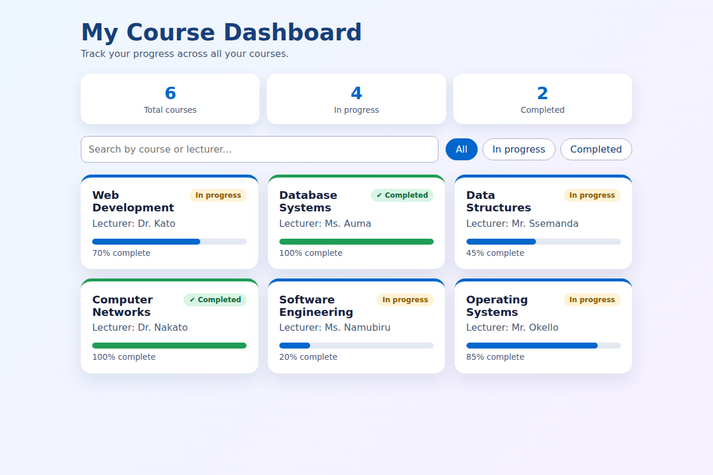
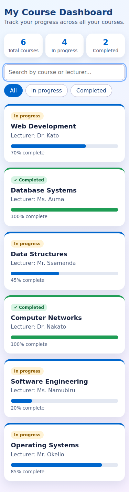

# Student Course Dashboard (Lab 1)

A responsive React dashboard built with Vite. It shows course cards with lecturer,
progress and status, plus summary totals, a search box and status filters.

**Student number:** S25D14-020
**GitHub:** https://github.com/nangiro123/workshop-registration-S25D14-020

## Setup

1. Install Node.js (v18 or newer) and VS Code.
2. Open this folder in VS Code, then open a terminal (Terminal > New Terminal).
3. Run:

```powershell
npm install
npm run dev
```

4. Open the local address shown in the terminal (usually http://localhost:5173).

Other commands: `npm run build` (production build), `npm run preview`.

## Component tree

```
App                      (state: search, filter; holds the courses array)
├── Summary              (props: total, completed, active)
├── Filters              (props: search, onSearch, filter, onFilter)
├── CourseCard × N       (prop: course; rendered with map(), key = course.id)
│   └── ProgressBar      (props: value, completed)
└── EmptyState           (props: message, hint)
```

## How the lab requirements are met

| Requirement | Where |
|---|---|
| Reusable cards receiving props | `src/components/CourseCard.jsx` |
| Array rendered with `map()` | `src/App.jsx` (`visibleCourses.map(...)`) |
| Stable key | `key={course.id}` (unique ids in `src/data/courses.js`) |
| Completed / In progress state | `completed ? ... : ...` in `CourseCard` |
| Empty state | `EmptyState` when there are no courses or no search match |
| Responsive layout | CSS grid with `auto-fit` plus a phone media query in `src/styles.css` |

## Extension feature

Live search (course or lecturer) and All / In progress / Completed filter buttons,
implemented with `useState` in `App` and passed down to `Filters` through props.

## Screenshots

Desktop: 

Phone (375px wide): 

## Testing the empty state

Set the array in `src/data/courses.js` to `[]` (or type nonsense in the search box)
and the empty message appears.
